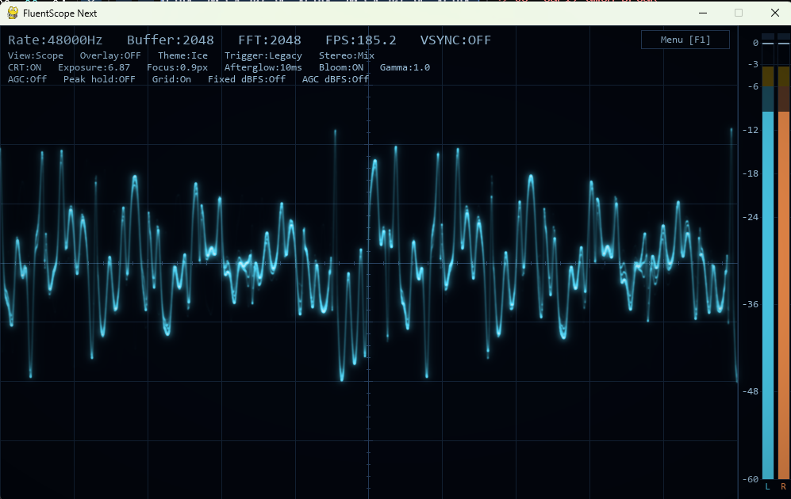
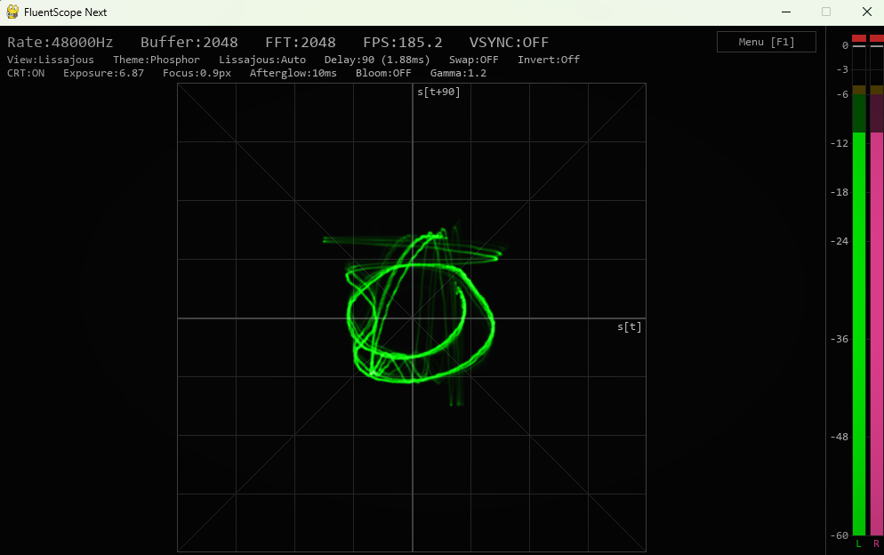
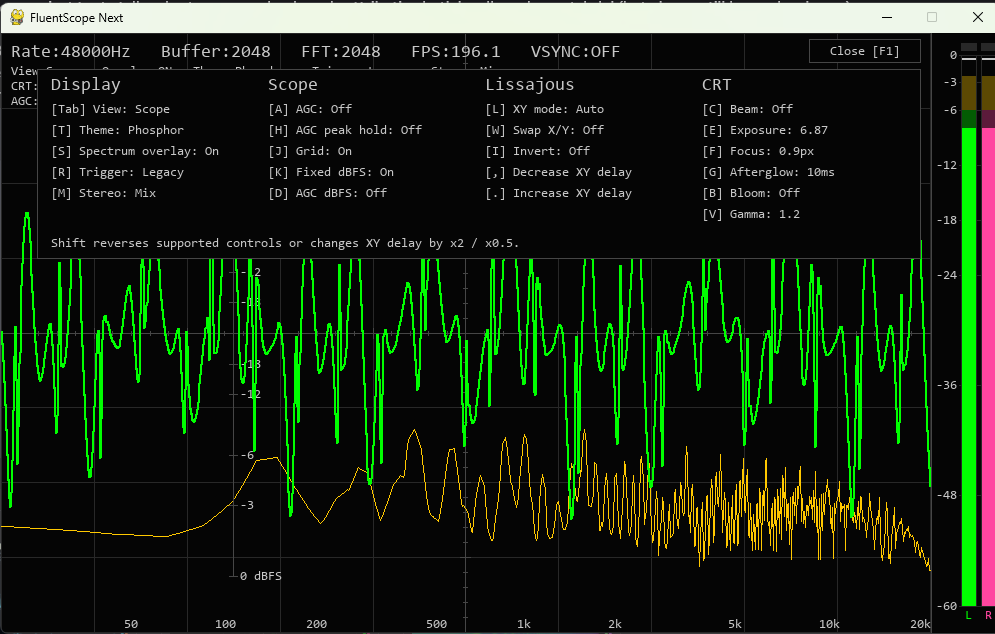
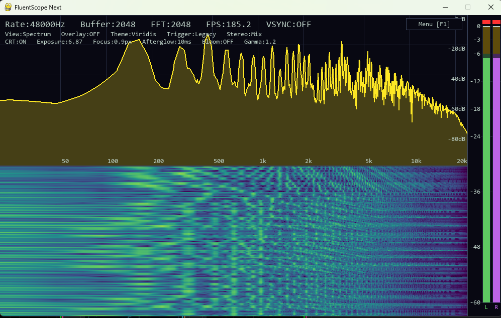

# FluentScope Next

FluentScope Next is a real-time audio oscilloscope and spectrum analyzer for audio capture devices exposed by PortAudio. Its window, input, text, and 2D graphics use pyglet 2.1; a graphics driver with OpenGL 3.3 core support is required.

- **Scope** shows triggered waveforms with stereo display options, level meters, and automatic gain control.
- **Spectrum** shows the frequency spectrum and a scrolling waterfall.
- **Lissajous** plots audio in X/Y mode for inspecting stereo phase relationships.
- **CRT rendering** adds a beam with adjustable focus, persistence, and bloom to the Scope and Lissajous views.
- **GL Line rendering** draws plain traces with OpenGL, with adjustable line width and optional anti-aliasing. Spectrum lines use the same renderer whenever OpenGL is active.

## Screenshots

### Scope with CRT rendering



### Lissajous view



### Controls menu



### Spectrum and waterfall



## Install and run

The commands below use Python 3.12 and Windows PowerShell.

```powershell
git clone https://github.com/src3453/fluentscope-next.git
cd fluentscope-next
py -3.12 -m venv .venv
.\.venv\Scripts\python.exe -m pip install -r requirements.txt
.\.venv\Scripts\python.exe fluentscope_next.py
```

Without a device argument, the last command opens a startup menu. Select **Input** for a microphone or line input, or **Output loopback** to capture audio playing through a Windows output device, then click **Start** (or double-click the device). Capture errors are shown in the menu so you can try another device. Cancel or Escape exits.

Windows uses [PyAudioWPatch](https://github.com/s0d3s/PyAudioWPatch) for WASAPI output loopback; no Stereo Mix device or virtual audio cable is required. macOS 13+ uses Apple's ScreenCaptureKit for driver-free system audio capture (see below). On Linux, select an OS-provided monitor or virtual input under **Input** for output capture. The startup menu requires Tkinter (included with standard Python on Windows; often packaged as `python3-tk` on Linux).

To update an existing environment, rerun `python -m pip install -r requirements.txt`. You can still select a device directly from the command line. Replace `0` with your device index from `--list-devices`.

```powershell
.\.venv\Scripts\python.exe fluentscope_next.py 0
.\.venv\Scripts\python.exe fluentscope_next.py --list-devices
.\.venv\Scripts\python.exe fluentscope_next.py --loopback
```

`--loopback` captures the default Windows WASAPI output, or system audio on macOS 13+. You can also pass a unique substring of a capture device name or use `"exact:Device Name"` to match the full name. If several capture devices have that exact name, startup stops with a warning and lists selectors such as `"exact:Device Name:1"` and `"exact:Device Name:2"`. The final number is the 1-based occurrence among devices with the same name, in `--list-devices` order (across audio APIs); duplicate entries in that list also show their numbered selectors. Names containing colons are supported; a matching full device name takes precedence over interpreting its final colon as an occurrence suffix. Device indices and occurrence order depend on the audio backend and connected devices; check the list again after upgrading. Windows loopback uses the output device's native sample rate and channel count; the first two channels are displayed. macOS system audio uses stereo at 48 kHz. Ordinary inputs use up to two channels at 48 kHz, with the native sample rate as a fallback. If PyAudio needs to build from source, install the PortAudio development headers for your platform first.

### macOS

Use macOS 13 (Ventura) or later for system audio capture. Install Python 3.12+ with Tkinter, PortAudio, and Apple Command Line Tools. For example, with Homebrew Python 3.12:

```sh
xcode-select --install
brew install python@3.12 python-tk@3.12 portaudio
python3.12 -m venv .venv
.venv/bin/python -m pip install -r requirements.txt
.venv/bin/python fluentscope_next.py --loopback
```

Alternatively, run without arguments and select **Output loopback → macOS System Audio**. No BlackHole, virtual driver, or output-device routing change is needed. This captures the system audio mix rather than an individual hardware output. A connected display is required by the [ScreenCaptureKit](https://developer.apple.com/documentation/screencapturekit) content filter. The helper registers only an audio output; screen frames are not read or saved.

The Swift helper in `native/macos_loopback.swift` is compiled on first use and cached in `~/Library/Caches/FluentScopeNext`. The first build may take a few minutes. Allow the macOS recording permission when prompted. If access is denied or startup times out, enable the launching terminal/app or capture helper in **System Settings → Privacy & Security → Screen & System Audio Recording** (named **Screen Recording** on older macOS releases), restart the launching app, and retry. Ordinary microphone inputs require the separate **Microphone** permission. Device listing does not request recording access. Older macOS releases can still use ordinary or virtual input devices; native system audio requires 13+.

To check the automated audio, window sizing, and rendering tests:

```sh
.venv/bin/python -m unittest discover -s tests -v
```

To enable the CRT and GL Line renderers, install ModernGL. SciPy is optional and enables polyphase resampling for the CRT trace. `requirements-full.txt` installs the required packages plus all optional ones:

```powershell
.\.venv\Scripts\python.exe -m pip install -r requirements-full.txt
```

Without ModernGL, traces and spectrum lines are drawn with pyglet. Pygame and SDL are no longer required. After updating an existing installation, reinstall `requirements.txt` (or `requirements-full.txt`) to add pyglet. Saved settings are retained; the former `Pygame` trace renderer is mapped to `Pyglet` automatically.

The optional native smoke tests open real windows with synthetic stereo audio, exercise all views and available renderers, and check input, resize, Retina scaling, and shutdown. They do not record microphone or system audio. Run them on a graphical desktop with:

```sh
FLUENTSCOPE_NATIVE_TESTS=1 .venv/bin/python -m unittest discover -s tests -v
```

## Controls

| Key | Action |
| --- | --- |
| F1 | Open the controls menu (works even when the menu button is hidden) |
| F2 | Show or hide the level meter |
| F3 | Show or hide the status text and menu button |
| F4 | Reset the window to its default size (1000x600) |
| F5 / Shift+F5 | Cycle the maximum frame rate: 30, 60, 120, 144, 180, 240, Unlimited (ignored while VSync is on) |
| F6 | Toggle VSync |
| F7 | Toggle Retina plot resolution (macOS, with ModernGL) |
| Tab or 1–3 | Cycle or select Scope, Spectrum, and Lissajous |
| S | Toggle the spectrum overlay |
| Q / Shift+Q | Cycle spectrum mode forward or backward: Log, Linear, Mel, Cepstrum |
| U / Shift+U | Cycle spectrum time smoothing: Off, Low, Med, High |
| Y / Shift+Y | Cycle spectrum dB range, or vertical zoom in Cepstrum |
| R / M | Cycle the trigger or stereo mode |
| X / Shift+X | Cycle the Scope time span forward or backward |
| P | Toggle step or smooth Scope lines (Pyglet and GL Line renderers) |
| A / H | Cycle automatic gain control (Scope and Lissajous) or toggle gain peak hold |
| J / K / D | Toggle the scope grid, fixed-gain dBFS labels, or AGC dBFS labels |
| L / W / I | Cycle the X/Y mode, swap axes, or change axis inversion |
| C / Shift+C | Cycle the trace renderer: CRT, GL Line, Pyglet (with ModernGL) |
| N / Shift+N | Make GL lines (GL Line traces and spectrum lines) thicker or thinner |
| O | Toggle anti-aliasing of GL lines |
| T / Shift+T | Cycle themes forward or backward |

The **Time span** control in the F1 menu selects how much audio the Scope shows across its horizontal axis. At 48 kHz the options are 5.33, 10.67, 21.33 (default), 42.67, and 85.33 ms.

On macOS, **Display → Retina resolution** in the F1 menu (or F7) switches the plot's offscreen render targets between logical and native display resolution immediately, without recreating the window or OpenGL context. It defaults to Off and is saved as `retina` in `fluentscope_settings.json`. Window size and mouse coordinates stay in logical points, and line widths retain their apparent size. The HUD and controls menu always render at native resolution, including their font glyphs. Moving between displays updates the rendering resolution automatically. Retina uses more GPU memory and processing on high-density displays; on a standard-density display both settings render at the same resolution. Without ModernGL, pyglet draws everything at native resolution and this option is hidden.

The **Mode** control in the F1 menu’s **Spectrum** group (or Q / Shift+Q) selects the analysis used by both the spectrum overlay and the Spectrum view, including its waterfall. Log (default), Linear, and Mel use the corresponding frequency axis with dBFS levels. Mel uses the standard 2595 log10(1 + f/700) mapping. Cepstrum shows the absolute real cepstrum of the log magnitude spectrum: the horizontal axis is quefrency in milliseconds, excluding zero, and the vertical axis is coefficient magnitude (0–1 at 1x zoom). Switching modes clears waterfall history to keep its axis consistent. The selected mode is saved and survives window resizing.

In the **Spectrum** menu, **Smoothing** (U / Shift+U) selects exponential time averaging: Off (default), Low (50 ms), Med (150 ms), or High (400 ms). It smooths both the plotted line and new waterfall rows, with timing independent of the frame rate. Off retains the original instant attack and falling peak line. **Range** (Y / Shift+Y) selects a 40, 60, 80, 100 (default), 120, or 140 dB span below 0 dBFS. In Cepstrum this control becomes **Zoom**, with vertical magnification of 1x (default), 2x, 4x, 8x, or 16x; the quefrency axis stays fixed. Range and zoom are remembered independently. These controls also affect the Scope overlay, are saved across restarts, and clear the waterfall when changed.

Settings are saved to `fluentscope_settings.json` beside the script.

## License

Copyright © 2026 src3453. FluentScope Next is distributed under the [MIT License](LICENSE). The upstream notices below apply to the respective third-party material.

### Dependencies

| Component | License and upstream notices |
| --- | --- |
| Python | [Python Software Foundation License](https://docs.python.org/3/license.html) |
| NumPy | [BSD 3-Clause and bundled component notices](https://numpy.org/doc/stable/license.html) |
| pyglet | [BSD 3-Clause](https://github.com/pyglet/pyglet/blob/master/LICENSE) |
| PyAudio | [MIT](https://pypi.org/project/PyAudio/) |
| PyAudioWPatch (Windows) | [MIT](https://github.com/s0d3s/PyAudioWPatch/blob/master/LICENSE.txt) |
| PortAudio | [MIT](https://github.com/PortAudio/portaudio/blob/master/LICENSE.txt) |
| ModernGL (optional) | [MIT](https://github.com/moderngl/moderngl/blob/main/LICENSE) |
| glcontext (via ModernGL) | [MIT](https://github.com/moderngl/glcontext/blob/main/LICENSE) |
| SciPy (optional) | [BSD 3-Clause and bundled component notices](https://github.com/scipy/scipy/blob/main/LICENSE.txt) |

### Upstream code and design credits

- The correlation trigger is based on [Corrscope](https://github.com/corrscope/corrscope) (BSD 2-Clause).
- The CRT beam model draws on [Hansi Raber's Oscilloscope](https://github.com/kritzikratzi/Oscilloscope) (MIT) and [woscope's beam-rendering write-up](https://m1el.github.io/woscope-how/) ([woscope code under MIT](https://github.com/m1el/woscope/blob/master/LICENSE)).

<details>
<summary>Corrscope — BSD 2-Clause</summary>

```text
BSD 2-Clause License

Copyright (c) 2018-2020+, nyanpasu64
All rights reserved.

Redistribution and use in source and binary forms, with or without
modification, are permitted provided that the following conditions are met:

* Redistributions of source code must retain the above copyright notice, this
  list of conditions and the following disclaimer.

* Redistributions in binary form must reproduce the above copyright notice,
  this list of conditions and the following disclaimer in the documentation
  and/or other materials provided with the distribution.

THIS SOFTWARE IS PROVIDED BY THE COPYRIGHT HOLDERS AND CONTRIBUTORS "AS IS"
AND ANY EXPRESS OR IMPLIED WARRANTIES, INCLUDING, BUT NOT LIMITED TO, THE
IMPLIED WARRANTIES OF MERCHANTABILITY AND FITNESS FOR A PARTICULAR PURPOSE ARE
DISCLAIMED. IN NO EVENT SHALL THE COPYRIGHT HOLDER OR CONTRIBUTORS BE LIABLE
FOR ANY DIRECT, INDIRECT, INCIDENTAL, SPECIAL, EXEMPLARY, OR CONSEQUENTIAL
DAMAGES (INCLUDING, BUT NOT LIMITED TO, PROCUREMENT OF SUBSTITUTE GOODS OR
SERVICES; LOSS OF USE, DATA, OR PROFITS; OR BUSINESS INTERRUPTION) HOWEVER
CAUSED AND ON ANY THEORY OF LIABILITY, WHETHER IN CONTRACT, STRICT LIABILITY,
OR TORT (INCLUDING NEGLIGENCE OR OTHERWISE) ARISING IN ANY WAY OUT OF THE USE
OF THIS SOFTWARE, EVEN IF ADVISED OF THE POSSIBILITY OF SUCH DAMAGE.
```

</details>

<details>
<summary>Oscilloscope — MIT</summary>

```text
MIT License

Copyright (c) 2017 hansi raber

Permission is hereby granted, free of charge, to any person obtaining a copy
of this software and associated documentation files (the "Software"), to deal
in the Software without restriction, including without limitation the rights
to use, copy, modify, merge, publish, distribute, sublicense, and/or sell
copies of the Software, and to permit persons to whom the Software is
furnished to do so, subject to the following conditions:

The above copyright notice and this permission notice shall be included in all
copies or substantial portions of the Software.

THE SOFTWARE IS PROVIDED "AS IS", WITHOUT WARRANTY OF ANY KIND, EXPRESS OR
IMPLIED, INCLUDING BUT NOT LIMITED TO THE WARRANTIES OF MERCHANTABILITY,
FITNESS FOR A PARTICULAR PURPOSE AND NONINFRINGEMENT. IN NO EVENT SHALL THE
AUTHORS OR COPYRIGHT HOLDERS BE LIABLE FOR ANY CLAIM, DAMAGES OR OTHER
LIABILITY, WHETHER IN AN ACTION OF CONTRACT, TORT OR OTHERWISE, ARISING FROM,
OUT OF OR IN CONNECTION WITH THE SOFTWARE OR THE USE OR OTHER DEALINGS IN THE
SOFTWARE.
```

</details>

<details>
<summary>woscope — MIT</summary>

```text
The MIT License

Copyright (c) 2015 Igor Null <m1el.2027@gmail.com>, Chad von Nau <chad@vonnau.com>

Permission is hereby granted, free of charge, to any person obtaining a copy
of this software and associated documentation files (the "Software"), to deal
in the Software without restriction, including without limitation the rights
to use, copy, modify, merge, publish, distribute, sublicense, and/or sell
copies of the Software, and to permit persons to whom the Software is
furnished to do so, subject to the following conditions:

The above copyright notice and this permission notice shall be included in
all copies or substantial portions of the Software.

THE SOFTWARE IS PROVIDED "AS IS", WITHOUT WARRANTY OF ANY KIND, EXPRESS OR
IMPLIED, INCLUDING BUT NOT LIMITED TO THE WARRANTIES OF MERCHANTABILITY,
FITNESS FOR A PARTICULAR PURPOSE AND NONINFRINGEMENT. IN NO EVENT SHALL THE
AUTHORS OR COPYRIGHT HOLDERS BE LIABLE FOR ANY CLAIM, DAMAGES OR OTHER
LIABILITY, WHETHER IN AN ACTION OF CONTRACT, TORT OR OTHERWISE, ARISING FROM,
OUT OF OR IN CONNECTION WITH THE SOFTWARE OR THE USE OR OTHER DEALINGS IN
THE SOFTWARE.
```

</details>
